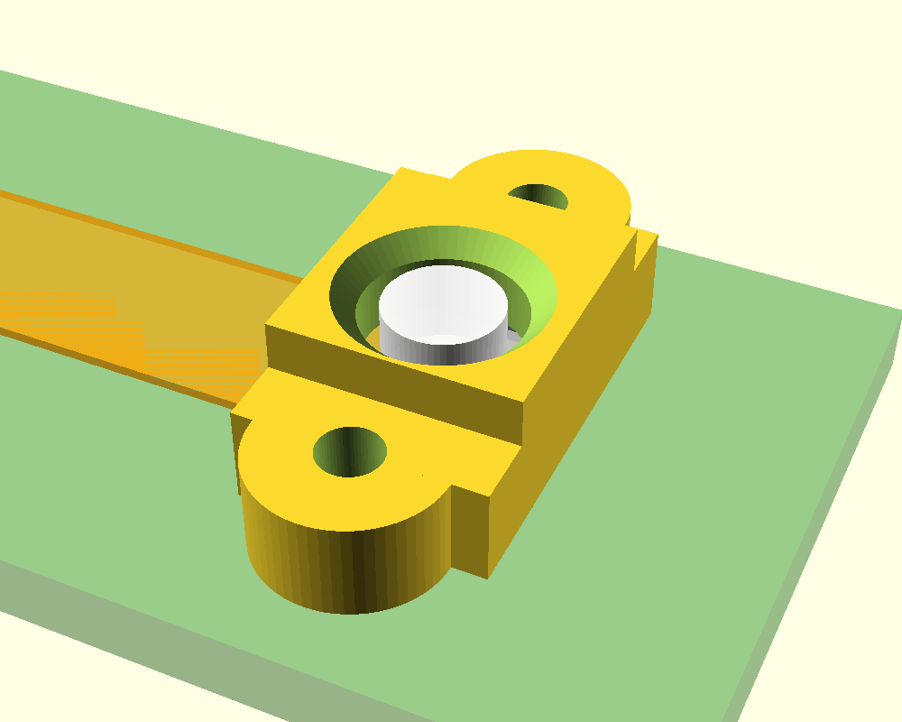

# BMV080 Shroud

[](https://github.com/romkey/bmv080-shroud/actions/workflows/openscad.yml)
[](LICENSE)
[](https://openscad.org/)
[](#ai-disclosure)

A small 3D-printable cage that holds a [Bosch BMV080](https://www.bosch-sensortec.com/products/environmental-sensors/particulate-matter-sensor/bmv080/)
particulate-matter sensor in place on the
[Sensr Air](https://github.com/romkey/sensr-air) `air-stcc4` PCB (v0.4.0).



*Preview: shroud (yellow) over the sensor head. The green PCB patch, orange flex
and the sensor are shown for reference only and are not part of the model.*

## What it does

The BMV080 is an LGA package on a 20 mm flex that plugs into the board's ZIF
connector. The sensor head just sits on the PCB, so it needs something to hold it
down and keep it aligned. The shroud:

- bridges the sensor head and fastens to the **two 1.3 mm plated holes** the PCB provides beside it
- locates the package in X/Y with a pocket and captures it with ~0.1 mm of headroom, so it is held
  but **not clamped** (Bosch allows at most 3 N on the package, and no force on the lens)
- leaves the lens and the laser path fully open, with a chamfered 3.4 mm window
- stands 0.3 mm proud of the lens top, so a finger or a tabletop touches plastic first

Overall size is about 5.5 x 13.2 x 3.3 mm.

## Files

| File | Purpose |
| --- | --- |
| [`bmv080_shroud.scad`](bmv080_shroud.scad) | Parametric OpenSCAD source |
| [`bmv080_shroud_screw.stl`](bmv080_shroud_screw.stl) | Ready to print, screw mounting |
| [`bmv080_shroud_peg.stl`](bmv080_shroud_peg.stl) | Ready to print, peg mounting (already flipped, pegs up) |
| [`ci-check.sh`](ci-check.sh) | Renders every variant and checks the result (used by CI) |

## Mounting

Two variants, selected with `mount` in the `.scad` file:

- **`screw`** (default): 1.4 mm through holes for M1.2 screws, with a nut on the back of the PCB.
  Use a smaller hole (about 1.0 mm) if you want to self-tap the screw from the back instead.
- **`peg`**: 1.15 mm pegs that go through the PCB holes and stick out 0.8 mm behind the board.
  Glue them or heat-stake them.

## Printing

- 0.1-0.12 mm layers, 0.4 mm nozzle (a 0.25 mm nozzle is nicer if you have one)
- Screw version: print as modelled, PCB face on the bed. The 1.5 mm pocket roof is a short bridge; no supports needed.
- Peg version: the STL is already oriented with the pegs pointing up.

## Customising

Open the `.scad` file in [OpenSCAD](https://openscad.org/) and use the Customizer panel,
or override parameters on the command line:

```bash
openscad -o shroud.stl -D 'mount="peg"' -D 'xy_clear=0.35' bmv080_shroud.scad
```

Useful parameters:

| Parameter | Default | Notes |
| --- | --- | --- |
| `mount` | `"screw"` | `"screw"` or `"peg"` |
| `lens_side` | `-1` | Flip to `1` if your lens sits on the other side of the flex centreline |
| `xy_clear` | `0.25` | Side clearance around the flex; raise it if the fit is tight |
| `z_clear` | `0.10` | Headroom above the package |
| `lens_clear` | `0.40` | Radial clearance around the lens |
| `tape_t` | `0.0` | Thickness of thermal tape under the flex, if used |
| `show_ghost` | `false` | Shows the PCB, flex and sensor for reference (don't export it) |

## Where the numbers come from

| What | Source |
| --- | --- |
| Hole positions (48.5, 22.5) and (48.5, 31.5), board thickness 1.6 mm | [`air-stcc4.kicad_pcb` v0.4.0](https://github.com/romkey/sensr-air/blob/main/hw/air-stcc4/0.4.0/air-stcc4.kicad_pcb) |
| Sensor head dimensions, lens position, handling forces | [BMV080 datasheet](https://github.com/romkey/sensr-air/blob/main/datasheets/BMV080.pdf) (Bosch BST-BMV080-DS000-12, section 3 and 4.1) |
| Mounting and thermal guidance | [BMV080 integration guideline](https://www.bosch-sensortec.com/media/boschsensortec/downloads/application_notes_1/bst-bmv080-an000-03.pdf) |

The shroud origin is the midpoint between the two holes. The sensor position along the
flex was taken from the PCB's silkscreen outline for the BMV080 footprint.

## Known limits

**This has not been test-fitted yet.** The geometry was derived from the datasheet and the
KiCad file and checked in OpenSCAD only. Before relying on it:

- print one and check it against a real board and sensor (adjust `xy_clear` / `z_clear` as needed)
- confirm which side of the flex the lens is on and set `lens_side` if needed
- note that this part only holds the sensor. Bosch also requires an optical cover with
  0.35 +/- 0.1 mm clearance above the lens, 17 mm from sharp edges, and a thermal path for the
  flex. None of that is provided here.

## CI

[GitHub Actions](.github/workflows/openscad.yml) installs OpenSCAD and runs
[`ci-check.sh`](ci-check.sh). It renders the screw, peg, reference and flipped-lens variants and
fails on any OpenSCAD warning or error, a non-manifold result, or an empty STL. The resulting
STLs are uploaded as a build artifact. You can run the same check locally:

```bash
./ci-check.sh
```

## AI disclosure

This project was written by AI under human guidance. The OpenSCAD model, scripts, CI
workflow and this README were produced by Anthropic's Claude (via Claude Code) while
[John Romkey](https://github.com/romkey) set the goals, supplied the PCB, and reviews the
results. Treat the dimensions as unverified until you have checked them against your own
hardware.

## License

[MIT](LICENSE). The Sensr Air PCB design is separately licensed under CERN-OHL-S; see
its [repository](https://github.com/romkey/sensr-air).
